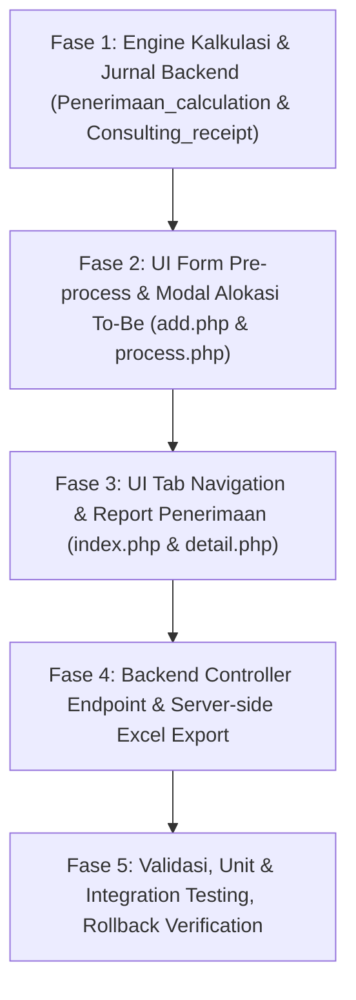

## Print lampiran PDF Transport — 26 Oktober 2026

Tujuan: setiap halaman PDF mendapat satu halaman cetak A4 tersendiri, utuh dan proporsional. Semua halaman dan urutan lampiran dipertahankan; tidak mengubah endpoint, database, atau audit.

1. Grounding dan RED: verifikasi route request_payment ke expense/transport_req_print, view iframe 600px, PDF.js lokal, serta regresi audit Batch4. Tambahkan tes Node untuk readiness, multipage, ukuran, urutan, dan failure.
2. Implementasi: render PDF.js lokal berurutan ke canvas; fit area A4 margin 10mm; tunggu PDF dan gambar; cetak otomatis hanya jika semuanya siap; tombol cetak ulang dan pesan/link file gagal.
3. Validasi: tes Node, syntax PHP bila tersedia, regresi audit Batch4, review diff/whitespace; perbarui checkpoint. Tanpa browser/web dan tanpa perubahan pekerjaan lain.

Kriteria selesai: tiap halaman PDF utuh pada halaman terpisah; landscape tidak terdistorsi; tidak mencetak otomatis saat lampiran gagal. Risiko: pengaturan dialog printer dapat mengubah skala/margin; hasil fisik tidak diverifikasi lewat web.

Status: seluruh fase selesai. Tes Node renderer dan syntax JS lulus; lint view PHP lulus; regresi Expense Batch4 lulus (51 fixture scenarios + 1 shutdown subprocess). Renderer memakai canvas 150 DPI dan tinggi area 276mm (sisa 1mm untuk pembulatan cetak). Bukti dan daftar file ada pada checkpoint Transport di docs/task-progress.md. Tidak ada pengujian browser atau cetak fisik.

# Implementation Plan: Pengembangan Modul Penerimaan Uang (Penerimaan Piutang Consultant To-Be)

## Problem & Background Context
Modul **Penerimaan Uang** (`application/modules/penerimaan_uang`) saat ini menangani pelunasan invoice berdasarkan mutasi bank dari modul alokasi. Berdasarkan spesifikasi konsep terbaru (`Penerimaan Piutang Consultant.html` dan `Penerimaan Piutang - Consultant.xlsx`), terdapat kebutuhan perbaikan alur untuk **Invoice Consulting (versi baru)**:
1. **Penguncian Jenis Pajak:** PPN tidak lagi dipilih secara manual lewat dropdown di form awal, melainkan terkunci dari invoice asal (PKP dengan PPN 12% dari DPP Lain, WAPU dengan PPN 0, dan Kawasan Berikat dengan PPN 0).
2. **Kalkulasi & Pemilihan PPh 23 Dinamis:** PPh 23 dipilih di pre-process (Dipotong PPh vs Tidak Dipotong PPh). Jika dipotong, default nilai adalah 2% x DPP Lain, namun **dapat diedit secara granular per invoice** pada modal alokasi (misal jika ada penyesuaian bukti potong).
3. **Penyelarasan Multi-Invoice & Sisa Piutang (Kurang Bayar):** User dapat memilih beberapa invoice sekaligus untuk satu mutasi transfer bank. Jika terdapat kurang bayar, dialokasikan ke Sisa Piutang, dan sistem menerapkan validasi **Kontrol (Zero-Balance Check)**: `(Piutang - PPh 23 - Biaya Admin - Sisa Piutang) - Uang Masuk = 0`.
4. **Pencatatan Jurnal Akuntansi Transparan:** Untuk kasus sisa piutang/kurang bayar, akun *Piutang Dagang Usaha* dicatat 2 baris: Kredit sebesar Total Piutang awal dan Debit sebesar Sisa Piutang.
5. **Restrukturisasi UI (Tab Navigation) & DataTables Server-Side:** Halaman index dipecah menjadi dua tab: **Tab 1: Penerimaan (Draft alokasi uang masuk)** dan **Tab 2: Report Penerimaan (Rekap penerimaan yang sudah Used / diproses dengan DataTables Server-Side, rincian invoice, filter Tahun, Bulan, Company, Search Bebas, dynamic footer total summary, dan Export Excel)**.
6. **Server-side Excel Export:** Ekspor laporan penerimaan ke Excel yang andal di backend tanpa dependensi CDN JS eksternal.
7. **Preservasi Rollback:** Transaksi yang jurnalnya masih berstatus Draft (`sts = '0'`) tetap dapat di-rollback.

---

## User Review Required

> [!IMPORTANT]
> **Keputusan Arsitektur & Lingkup (Sudah Disepakati via `/grill-me`):**
> 1. **Cakupan Fitur:** Fokus implementasi pada alur Penerimaan Piutang & Report Penerimaan To-Be sesuai Mockup HTML. Fitur Deposit ditiadakan secara definitif sesuai arahan user (tidak diperlukan dalam sistem).
> 2. **Target Transaksi:** Alur To-Be ini berlaku untuk Invoice Consulting (versi baru). Invoice non-konsultasi / legacy tetap aman menggunakan jalur kompatibilitas yang sudah ada.
> 3. **Pencatatan Jurnal Sisa Piutang:** Dicatat 2 baris pada akun Piutang Dagang Usaha (Gross Credit `saldo_piutang` dan Debit `sisa_piutang`).
> 4. **Export Excel:** Menggunakan server-side controller stream (standar CodeIgniter) agar tidak bergantung pada CDN JS.
> 5. **Rollback:** Tetap tersedia pada Tab Report Penerimaan dan modal Detail untuk transaksi yang belum diposting (`sts = '0'`).

---

## Proposed Changes

The changes will be executed in **5 distinct phases**:



---

### Component 1: Engine Kalkulasi & Jurnal (`Penerimaan_calculation.php` & `Consulting_receipt.php`)

Menyesuaikan kalkulasi perlakuan pajak konsultasi, per-invoice editable PPh 23, validasi kontrol zero balance, dan penyusunan baris jurnal (2 baris untuk piutang dagang jika terdapat sisa piutang).

#### [MODIFY] [application/modules/penerimaan_uang/libraries/Penerimaan_calculation.php](file:///C:/web_dev/sendigs_finance/application/modules/penerimaan_uang/libraries/Penerimaan_calculation.php)
- Menambahkan helper kalkulasi perlakuan PPN & PPh sesuai tipe pajak:
  - PKP: `dpp_lain = round(penjualan * 11/12)`, `ppn = round(dpp_lain * 0.12)`, `pph = round(dpp_lain * 0.02)`. `tagihan = penjualan + ppn`.
  - WAPU: `dpp_lain = round(penjualan * 11/12)`, `ppn = 0`, `pph = round(dpp_lain * 0.02)`. `tagihan = penjualan`.
  - Kawasan Berikat: `dpp_lain = round(penjualan * 11/12)`, `ppn = 0`, `pph = round(dpp_lain * 0.02)`. `tagihan = penjualan`.
- Menambahkan metode validasi Kontrol: `kontrol = (piutang - pph - admin - sisa) - uang_masuk`.
- Validasi batas maksimal biaya admin (maks Rp 10.000).

#### [MODIFY] [application/modules/penerimaan_uang/libraries/Consulting_receipt.php](file:///C:/web_dev/sendigs_finance/application/modules/penerimaan_uang/libraries/Consulting_receipt.php)
- Memperbarui `invoice_context` untuk mendeteksi `tax_treatment` (PKP, WAPU, Kawasan Berikat) dari invoice.
- Memperbarui `preview` dan `save`:
  - Menerima `pph_actual` per invoice (default 2% DPP Lain jika Dipotong PPh, 0 jika Tidak Dipotong).
  - Menyusun jurnal:
    - Akun Bank: Debit `piutang - pph - admin - sisa`.
    - Akun PPh 23 Disetor: Debit `pph` (jika > 0).
    - Akun Biaya Admin: Debit `admin` (jika > 0).
    - Akun Piutang Dagang Usaha: Kredit `piutang`.
    - Akun Piutang Dagang Usaha: Debit `sisa` (jika sisa > 0).
  - Mengupdate `saldo_piutang` di `tr_invoicing` menjadi `sisa`.
  - Menyimpan rincian alokasi di `tr_penerimaan_piutang_detail`.

---

### Component 2: UI Form Pre-process & Modal Alokasi To-Be

Mengadaptasi tampilan form pemilihan invoice dan modal alokasi sesuai mockup `Penerimaan Piutang Consultant.html`.

#### [MODIFY] [application/modules/penerimaan_uang/views/add.php](file:///C:/web_dev/sendigs_finance/application/modules/penerimaan_uang/views/add.php)
- Menghilangkan dropdown `ppn_dipotong` dari form pre-process (karena PPN terkunci otomatis dari invoice).
- Hanya menyisakan:
  - `Nama Customer` (Select2/Chosen).
  - `PPH23 Dipotong` (Dipotong PPh / Tidak Dipotong PPh).
  - `Nominal Penerimaan Bank` (Readonly dari alokasi split).
- Tabel daftar invoice menampilkan kolom:
  `Tgl Invoice`, `Nomor Invoice`, `TAX Code` (badge PKP, WAPU, KB), `Penjualan`, `DPP`, `PPN`, `PPH 23`, `Total Tagihan (Penjualan+PPN)`, `Total Tagihan - PPH`, `Saldo Piutang`, `Pilih (Checkbox)`.

#### [MODIFY] [application/modules/penerimaan_uang/views/consulting_process.php](file:///C:/web_dev/sendigs_finance/application/modules/penerimaan_uang/views/consulting_process.php) (atau view modal alokasi)
- Tabel alokasi interaktif:
  - Kolom: `Nomor Invoice`, `TAX Code`, `Penjualan`, `DPP`, `PPN`, `PPH 23` (input number / autonumeric, editable jika Dipotong PPh), `Total Tagihan`, `Total Tagihan - PPH`, `Piutang Dagang`, `Alokasi Penerimaan`, `Biaya Admin`, `Sisa Piutang`.
  - Footer rekonsiliasi: Total Piutang, Uang Masuk, Kontrol.
  - Peringatan dinamis jika Kontrol $\neq 0$ atau Admin > 10.000.
  - Preview Jurnal Penerimaan secara real-time di bawah tabel dengan balancing debit/kredit.
  - Tombol Proses hanya aktif jika Kontrol == 0.

---

### Component 3: UI Tab Navigation & Report Penerimaan (`index.php` & `detail.php`)

#### [MODIFY] [application/modules/penerimaan_uang/views/index.php](file:///C:/web_dev/sendigs_finance/application/modules/penerimaan_uang/views/index.php)
- Menambahkan Tab Navigation di bagian atas konten:
  - **Tab 1: Penerimaan (Draft)**:
    - Filter Bank.
    - Tabel DataTables uang masuk berstatus Draft yang siap dialokasikan.
    - Kolom Action: Tombol "Proses" (mengarahkan ke `add_penerimaan_uang/$id`).
  - **Tab 2: Report Penerimaan (Used)**:
    - Filter Tahun, Bulan, Company, dan Search teks bebas.
    - Tombol "Export to Excel".
    - Tabel rekap penerimaan yang sudah diproses dengan rowspan transfer bank.
    - Kolom Action: Tombol "Lihat" (detail modal) dan Tombol "Rollback" (jika `sts = '0'`).

#### [MODIFY] [application/modules/penerimaan_uang/views/detail.php](file:///C:/web_dev/sendigs_finance/application/modules/penerimaan_uang/views/detail.php)
- Menampilkan rincian penerimaan sesuai mockup: info customer, tanggal, bank, status PPh, uang masuk, tabel alokasi invoice, tabel Jurnal Penerimaan Piutang, serta tombol Rollback jika jurnal belum diposting.

---

### Component 4: Controller & Server-side Export Endpoint

#### [MODIFY] [application/modules/penerimaan_uang/controllers/Penerimaan_uang.php](file:///C:/web_dev/sendigs_finance/application/modules/penerimaan_uang/controllers/Penerimaan_uang.php)
- Memperbarui `index()` untuk menyediakan data filter tahun, bulan, dan company.
- Menambahkan method `get_report_penerimaan()` (AJAX/DataTables untuk Tab 2).
- Menambahkan method `export_excel()`:
  - Menarik data penerimaan yang sudah diproses berdasarkan filter (tahun, bulan, company).
  - Menghasilkan file Excel berformat `.xls`/`.xlsx` dengan kolom lengkap sesuai mockup HTML:
    `No, Tanggal Penerimaan, Bank, Detail Penerimaan Bank, Customer, Nomor Invoice, Company, TAX Code, PPh 23 Dipotong, Nominal PPh 23, Penerimaan Bank, Piutang Dagang, Alokasi Penerimaan, Biaya Admin, Sisa Piutang`.
- Menyesuaikan `add_penerimaan_uang()`, `process_alokasi()`, dan `save_penerimaan_piutang()` untuk mendukung alur baru tanpa dropdown PPN manual.

#### [NEW] [application/modules/penerimaan_uang/views/export_excel.php](file:///C:/web_dev/sendigs_finance/application/modules/penerimaan_uang/views/export_excel.php)
- Template view output server-side Excel dengan styling header dan number format khusus akuntansi (`#,##0.00`).

---

### Component 5: Model & Database Queries

#### [MODIFY] [application/modules/penerimaan_uang/models/Penerimaan_uang_model.php](file:///C:/web_dev/sendigs_finance/application/modules/penerimaan_uang/models/Penerimaan_uang_model.php)
- Menambahkan method query untuk penarikan data Report Penerimaan (menggabungkan `tr_penerimaan_piutang`, `tr_penerimaan_piutang_detail`, `tr_invoicing`, `tr_alokasi_split`, `ms_bank`, dan `tr_jurnal`).
- Query filter tahun unik dan company.

---

## Verification Plan

### Automated Tests
1. **Unit Testing Kalkulasi Pajak & Kontrol:**
   - Test case PKP (DPP 11/12, PPN 12%, PPh 2%).
   - Test case WAPU (DPP 11/12, PPN 0, PPh 2%).
   - Test case Kawasan Berikat (DPP 11/12, PPN 0, PPh 2%).
   - Test case Kontrol `(Piutang - PPh - Admin - Sisa) - Uang Masuk = 0`.
   - Test case Biaya Admin > 10.000 (harus rejected).
2. **Integration Test Jurnal Double Entry:**
   - Verifikasi total Debit == total Kredit.
   - Verifikasi 2 baris Piutang Dagang Usaha (Gross Credit dan Sisa Debit) saat ada kurang bayar.
   - Verifikasi akun Bank, PPh 23, dan Biaya Admin sesuai company penawaran.
3. **Execution Command:**
   ```powershell
   php vendor/phpunit/phpunit/phpunit application/modules/penerimaan_uang/tests/
   ```

### Manual Verification
1. Buka modul `penerimaan_uang`: pastikan Tab Navigation ("Penerimaan" & "Report Penerimaan") tampil rapi.
2. Pada Tab 1, pilih mutasi bank draft dan klik "Proses":
   - Pastikan dropdown Customer & PPh 23 tampil (tanpa dropdown PPN).
   - Pastikan invoice konsultasi memunculkan badge TAX Code yang sesuai (PKP / WAPU / KB).
   - Centang 1 atau lebih invoice, klik Proses:
   - Di modal alokasi, verifikasi perhitungan otomatis DPP, PPN, dan PPh 23.
   - Uji edit PPh 23, isi biaya admin, dan isi sisa piutang.
   - Pastikan indikator Kontrol berubah secara real-time dan submit terkunci sampai Kontrol == 0.
   - Verifikasi draft jurnal yang muncul di bawah tabel sudah balancing.
3. Simpan penerimaan:
   - Pastikan data berhasil tersimpan, saldo piutang invoice berkurang/tersisa sesuai input, dan jurnal terbentuk di `tr_jurnal`.
   - Transaksi berpindah ke Tab 2 ("Report Penerimaan").
4. Pada Tab 2:
   - Uji filter Tahun, Bulan, dan Company.
   - Klik tombol "Export to Excel" dan pastikan file Excel terunduh dengan data yang akurat.
   - Klik tombol "Lihat" untuk memeriksa detail transaksi.
   - Jika jurnal masih Draft, pastikan tombol "Rollback" tersedia dan berfungsi membatalkan penerimaan dengan aman.
